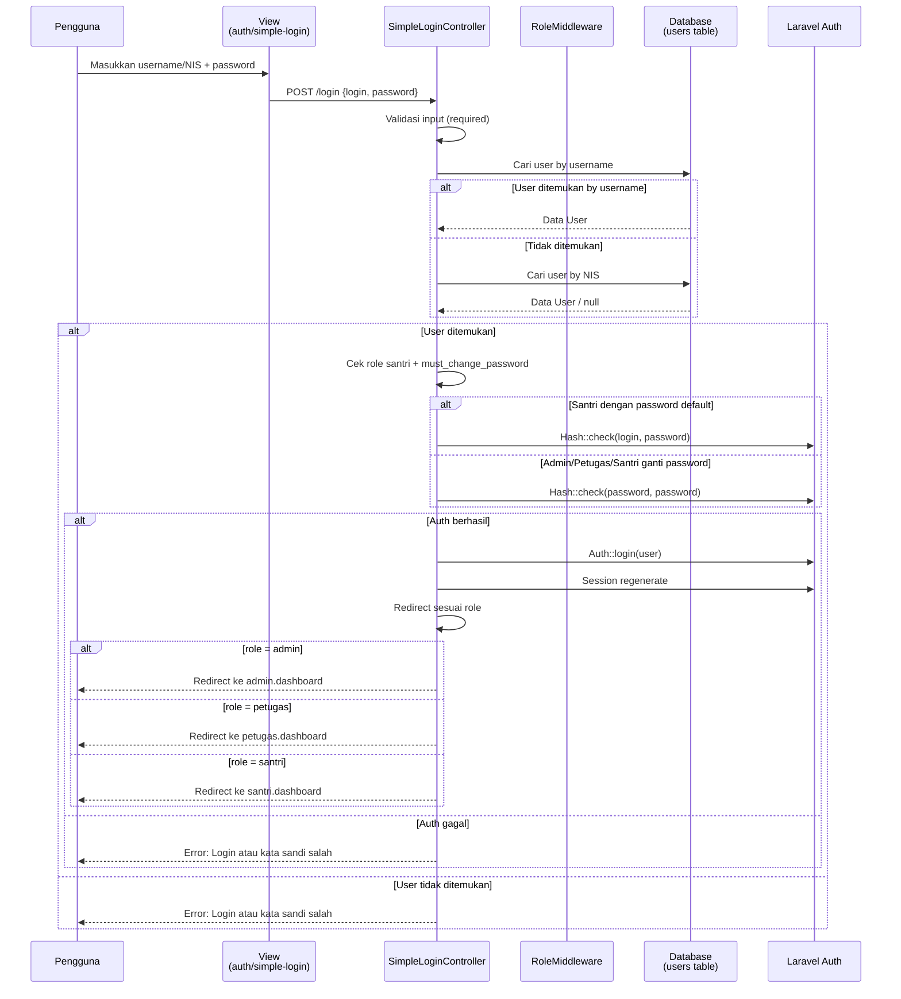
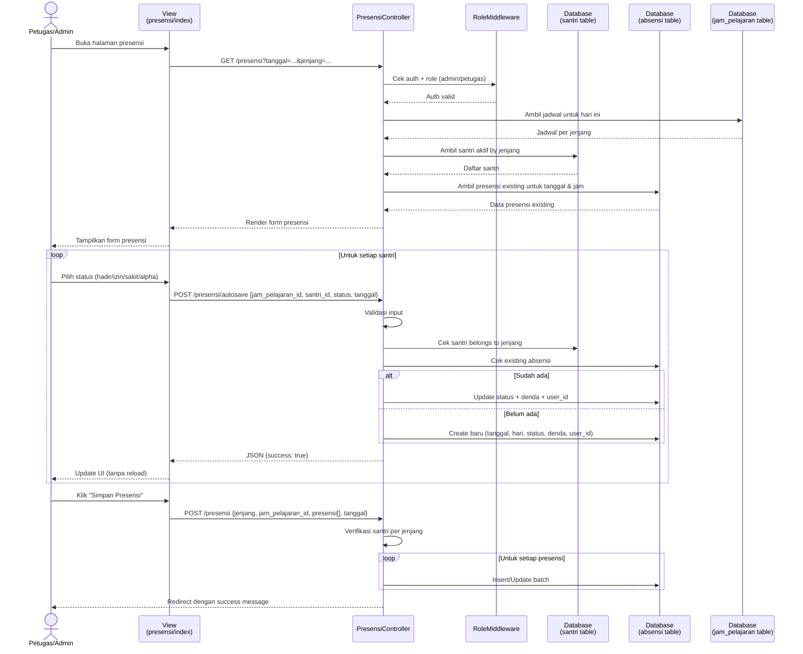
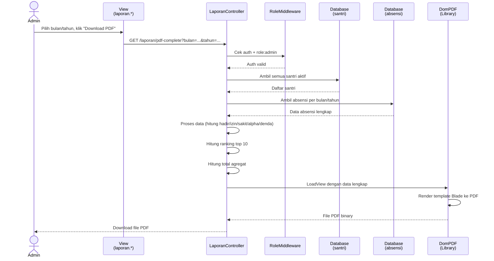

# DOKUMEN ANALISIS KEBUTUHAN SISTEM
## Sistem Presensi Pondok Pesantren

---

## 1. ANALISIS KEBUTUHAN SISTEM

### 1.1 Kebutuhan Fungsional (Functional Requirements)

#### 1.1.1 Autentikasi dan Manajemen Akun
- **FR-01: Login** - Pengguna dapat login menggunakan username (untuk admin/petugas) atau NIS (untuk santri)
- **FR-02: Logout** - Pengguna dapat melakukan logout dari sistem
- **FR-03: Verifikasi Email** - Sistem mendukung verifikasi email untuk akun yang mendaftar
- **FR-04: Reset Password** - Admin dapat mereset password pengguna lain ke nilai default (NIS/username)
- **FR-05: Ganti Password** - Pengguna dapat mengubah password mereka sendiri
- **FR-06: Force Change Password** - Santri baru diwajibkan mengganti password default pada login pertama kali

#### 1.1.2 Manajemen Data Santri
- **FR-07: Tambah Santri** - Admin dapat menambahkan data santri baru (NIS, nama, alamat, no HP, tanggal lahir, nama orang tua, jenjang, kelas)
- **FR-08: Lihat Daftar Santri** - Admin dapat melihat daftar santri dengan pencarian (nama/NIS) dan filter (jenjang)
- **FR-09: Detail Santri** - Admin dapat melihat detail santri lengkap dengan riwayat absensi
- **FR-10: Edit Santri** - Admin dapat mengubah data santri
- **FR-11: Hapus Santri** - Admin dapat menghapus data santri beserta akun pengguna yang terkait
- **FR-12: Reset Password Santri** - Admin dapat mereset password santri ke NIS default
- **FR-13: Manajemen Users** - Admin dapat melihat dan mengelola akun pengguna (admin/petugas/santri aktif)

#### 1.1.3 Manajemen Jadwal Pelajaran
- **FR-14: Lihat Jadwal** - Admin dapat melihat jadwal pelajaran per hari
- **FR-15: Tambah Jadwal** - Admin dapat menambahkan jadwal pelajaran (nama, ustadz, jam mulai, jam selesai, hari, urutan, kelas)
- **FR-16: Edit Jadwal** - Admin dapat mengubah jadwal pelajaran yang sudah ada
- **FR-17: Hapus Jadwal** - Admin dapat menghapus jadwal pelajaran

#### 1.1.4 Pencatatan Presensi
- **FR-18: Input Presensi Massal** - Admin/Petugas dapat input presensi untuk seluruh santri dalam satu sesi (hadir/izin/sakit/alpha)
- **FR-19: Autosave Presensi** - Sistem menyimpan otomatis perubahan presensi individual via AJAX
- **FR-20: Edit Presensi** - Admin dapat mengubah data presensi yang sudah tercatat
- **FR-21: Filter Presensi** - Admin dapat memfilter presensi berdasarkan jenjang (Safinatunnajah/Muqodimah) dan tanggal
- **FR-22: Lihat Jadwal Hari Ini** - Menampilkan jadwal pelajaran untuk hari ini di dashboard

#### 1.1.5 Rekapitulasi dan Laporan
- **FR-23: Rekap Presensi Bulanan** - Menampilkan rekapitulasi presensi per santri per bulan (hadir, izin, sakit, alpha, persentase)
- **FR-24: Rekap Denda Bulanan** - Menampilkan daftar denda yang terakumulasi per santri per bulan
- **FR-25: Ranking Kehadiran** - Menampilkan peringkat kehadiran santri
- **FR-26: Export Excel** - Admin dapat mengunduh laporan rekap presensi dalam format Excel
- **FR-27: Print/Preview** - Admin dapat melihat dan mencetak laporan rekap
- **FR-28: Laporan PDF** - Admin dapat mengunduh berbagai laporan dalam format PDF:
  - Laporan Presensi Bulanan
  - Laporan Rekap Absensi
  - Laporan Denda
  - Laporan Ranking
  - Laporan Lengkap ( gabungan presensi + denda + ranking)
- **FR-29: Filter Laporan** - Laporan dapat difilter berdasarkan bulan, tahun, kelas, dan pencarian nama santri

#### 1.1.6 Statistik dan Dashboard
- **FR-30: Dashboard Admin** - Menampilkan statistik hari ini (total santri, hadir, alpha, izin, sakit, persentase), denda hari ini, ranking terbaik bulan ini, jadwal hari ini, dan chart tren bulanan
- **FR-31: Dashboard Petugas** - Menampilkan statistik presensi hari ini khusus petugas (total santri, jumlah hadir/belum, persentase per jenjang, santri yang belum presensi)
- **FR-32: Dashboard Santri** - Menampilkan ringkasan presensi pribadi santri (total hadir, izin, sakit, alpha, persentase, total denda)
- **FR-33: Statistik Bulanan** - Admin dapat melihat statistik grafik kehadiran per bulan
- **FR-34: Riwayat Presensi Santri** - Santri dapat melihat riwayat kehadiran pribadi dengan filter bulan/tahun
- **FR-35: Riwayat Denda Santri** - Santri dapat melihat riwayat dan total denda yang terakumulasi
- **FR-36: Ranking Santri** - Santri dapat melihat ranking kehadiran
- **FR-37: Statistik Pribadi** - Santri dapat melihat grafik statistik kehadiran pribadi

#### 1.1.7 Pengaturan Sistem
- **FR-38: Reset Presensi** - Admin dapat mereset semua data presensi
- **FR-39: Reset Santri** - Admin dapat mereset semua data santri
- **FR-40: Template Import Santri** - Admin dapat mengunduh template Excel untuk import data santri massal
- **FR-41: Profil Admin** - Admin dapat mengedit dan menghapus profil akunnya

#### 1.1.8 Peran Pengguna (Role-Based Access)
- **FR-42: Role Admin** - Akses penuh ke seluruh fitur sistem
- **FR-43: Role Petugas** - Akses ke input/edit presensi, dashboard presensi, dan pengaturan profil
- **FR-44: Role Santri** - Akses terbatas ke dashboard pribadi, riwayat presensi, riwayat denda, ranking, dan statistik pribadi

---

### 1.2 Kebutuhan Non-Fungsional (Non-Functional Requirements)

#### 1.2.1 Keamanan (Security)
- **NFR-S01: Otentikasi Berbasis Peran (RBAC)** - Sistem menggunakan Role-Based Access Control dengan tiga peran: Admin, Petugas, dan Santri. Setiap route dilindungi oleh middleware `auth` dan `role` yang memeriksa peran pengguna sebelum memberikan akses.
- **NFR-S02: Hash Password** - Password disimpan dalam bentuk ter-hash menggunakan bcrypt (Laravel default), bukan plain text.
- **NFR-S03: Proteksi Route** - Semua route sensitif dilindungi middleware `auth`, route eksekutif hanya untuk user yang sudah terotentikasi.
- **NFR-S04: Verifikasi Email** - Route verifikasi email menggunakan token yang ditandatangani (`signed`) dan memiliki rate limiting (`throttle:6,1`) untuk mencegah spam.
- **NFR-S05: Regenerasi Session ID** - Setelah login, session ID diregenerasi untuk mencegah session fixation attacks.
- **NFR-S06: Validasi Input** - Semua input diverifikasi menggunakan Laravel Validator untuk mencegah injection dan data yang tidak valid.
- **NFR-S07: Proteksi Dati Sensitif** - Field `password` dan `remember_token` disembunyikan (hidden) dari serialisasi model User.
- **NFR-S08: Auto-Logout** - Route logout melakukan invalidasi session dan regenerasi CSRF token.
- **NFR-S09: Middleware Role-Based Redirect** - Jika pengguna mencoba mengakses route yang tidak sesuai perannya, sistem melakukan redirect ke dashboard yang sesuai dengan peran mereka.

#### 1.2.2 Kecepatan (Performance)
- **NFR-P01: Query Aggregasi Database** - Data rekap menggunakan query agregasi SQL (`GROUP BY`, `SUM`, `COUNT`) untuk menghitung statistik secara efisien, bukan loading semua data ke memori.
- **NFR-P02: Eager Loading** - Penggunaan `with('santri')` pada query Absensi untuk menghindari N+1 query problem.
- **NFR-P03: Pagination** - Data santri dan rekap menggunakan pagination (15-20 item per halaman) untuk mengurangi beban memori dan waktu loading.
- **NFR-P04: Selective Field Selection** - Beberapa query menggunakan `select()` untuk mengambil hanya field yang diperlukan.
- **NFR-P05: Caching Jadwal** - Jadwal pelajaran diambil per hari dan dikelompokkan oleh jenis (Safinatunnajah/Muqodimah) untuk optimasi.
- **NFR-P06: Bulk Operations** - Autosave presensi menggunakan batch insert/update untuk menangani multiple santri sekaligus.

#### 1.2.3 Keandalan (Reliability)
- **NFR-R01: Transaksi Implisit** - Setiap operasi create/update menggunakan Eloquent ORM yang mendukung transaksi database.
- **NFR-R02: Unique Constraint** - Tabel `absensi` memiliki unique constraint pada kombinasi `santri_id + jam_pelajaran_id + tanggal` untuk mencegah duplikasi data presensi.
- **NFR-R03: Validasi Data** - Semua operasi memiliki validasi input yang ketat (required, exists, in, date) untuk menjaga konsistensi data.
- **NFR-R04: Default Values** - Model Absensi menggunakan booted event untuk mengisi nilai default `tanggal` (tanggal hari ini) dan `denda` (berdasarkan status) secara otomatis.
- **NFR-R05: Error Handling** - Controller autosave menggunakan try-catch untuk menangani exception dan mengembalikan response JSON dengan error message.
- **NFR-R06: Soft Integrity** - Penghapusan santri juga menghapus akun pengguna terkait untuk menjaga integritas referensial.
- **NFR-R07: Logging** - Sistem menggunakan Laravel Log untuk mencatat aktivitas penting (debug jadwal, aktivitas presensi).
- **NFR-R08: Fallback View** - DashboardController memiliki logika untuk memilih view yang sesuai berdasarkan peran pengguna.

---

## 2. DIAGRAM UML

### 2.1 Use Case Diagram

```mermaid
graph TB
    subgraph "Aktor"
        ADMIN["👨‍💼 Admin<br/>(Administrator)"]
        PETUGAS["👷 Petugas<br/>(Staff/Operator)"]
        SANTRI["🎓 Santri<br/>(Siswa)"]
    end

    subgraph "Use Cases - Manajemen Akun"
        UC_LOGIN["Login ke Sistem"]
        UC_LOGOUT["Logout dari Sistem"]
        UC_GANTI_PASS["Ganti Password"]
    end

    subgraph "Use Cases - Admin"
        UC_KELOLA_SANTRI["Kelola Data Santri<br/>(Tambah/Edit/Hapus)"]
        UC_RESET_PASS_SANTRI["Reset Password Santri"]
        UC_ATUR_JADWAL["Kelola Jadwal Pelajaran"]
        UC_INPUT_PRESENSI["Input/Edit Presensi"]
        UC_REKAP_PRESENSI["Lihat Rekap Presensi Bulanan"]
        UC_REKAP_DENDA["Lihat Rekap Denda"]
        UC_RANKING["Lihat Ranking Kehadiran"]
        UC_EXPORT_EXCEL["Export Excel"]
        UC_PRINT_LAPORAN["Print Laporan"]
        UC_GEN_PDF["Generate Laporan PDF"]
        UC_KELOLA_USERS["Kelola Users"]
        UC_PENGATURAN["Pengaturan Sistem"]
        UC_DASHBOARD_ADMIN["Lihat Dashboard Admin"]
        UC_STATISTIK["Lihat Statistik Bulanan"]
    end

    subgraph "Use Cases - Petugas"
        UC_DASHBOARD_PETUGAS["Lihat Dashboard Petugas"]
        UC_PRESENSI_PETUGAS["Input/Edit Presensi"]
        UC_JADWAL_HARI_INI["Lihat Jadwal Hari Ini"]
    end

    subgraph "Use Cases - Santri"
        UC_DASHBOARD_SANTRI["Lihat Dashboard Pribadi"]
        UC_RIWAYAT_ABSEN["Lihat Riwayat Absensi"]
        UC_RIWAYAT_DENDA["Lihat Riwayat Denda"]
        UC_RANKING_SANTRI["Lihat Ranking Kehadiran"]
        UC_STATISTIK_SANTRI["Lihat Statistik Pribadi"]
        UC_EDIT_PROFIL["Edit Profil Pribadi"]
    end

    ADMIN --> UC_LOGIN
    ADMIN --> UC_LOGOUT
    ADMIN --> UC_GANTI_PASS
    ADMIN --> UC_KELOLA_SANTRI
    ADMIN --> UC_RESET_PASS_SANTRI
    ADMIN --> UC_ATUR_JADWAL
    ADMIN --> UC_INPUT_PRESENSI
    ADMIN --> UC_REKAP_PRESENSI
    ADMIN --> UC_REKAP_DENDA
    ADMIN --> UC_RANKING
    ADMIN --> UC_EXPORT_EXCEL
    ADMIN --> UC_PRINT_LAPORAN
    ADMIN --> UC_GEN_PDF
    ADMIN --> UC_KELOLA_USERS
    ADMIN --> UC_PENGATURAN
    ADMIN --> UC_DASHBOARD_ADMIN
    ADMIN --> UC_STATISTIK
    ADMIN --> UC_EDIT_PROFIL

    PETUGAS --> UC_LOGIN
    PETUGAS --> UC_LOGOUT
    PETUGAS --> UC_GANTI_PASS
    PETUGAS --> UC_DASHBOARD_PETUGAS
    PETUGAS --> UC_PRESENSI_PETUGAS
    PETUGAS --> UC_JADWAL_HARI_INI

    SANTRI --> UC_LOGIN
    SANTRI --> UC_LOGOUT
    SANTRI --> UC_GANTI_PASS
    SANTRI --> UC_DASHBOARD_SANTRI
    SANTRI --> UC_RIWAYAT_ABSEN
    SANTRI --> UC_RIWAYAT_DENDA
    SANTRI --> UC_RANKING_SANTRI
    SANTRI --> UC_STATISTIK_SANTRI
    SANTRI --> UC_EDIT_PROFIL
```



---

### 2.2 Sequence Diagram - Proses Login



---

### 2.3 Sequence Diagram - Proses Input Presensi



---

### 2.4 Sequence Diagram - Proses Cetak Laporan PDF



---

### 2.5 Class Diagram / Component Diagram

```mermaid
graph TD
    subgraph "Frontend Layer"
        AUTH_VIEWS["auth/*.blade.php"]
        ADMIN_VIEWS["admin/*.blade.php"]
        SANTRI_VIEWS["santri/*.blade.php"]
        PRESENSI_VIEWS["presensi/*.blade.php"]
        REKAP_VIEWS["rekap/*.blade.php"]
        LAPORAN_VIEWS["laporan/*.blade.php"]
        JAM_PELAJARAN_VIEWS["jam-pelajaran/*.blade.php"]
        PROFILE_VIEWS["profile/*.blade.php"]
        COMPONENTS["components/*.blade.php"]
    end

    subgraph "Routing Layer"
        WEB_ROUTES["routes/web.php"]
        AUTH_ROUTES["routes/auth.php"]
    end

    subgraph "Middleware Layer"
        AUTH_MW["auth"]
        ROLE_MW["role:admin|petugas|santri"]
        GUEST_MW["guest"]
        VERIFIED_MW["verified"]
        THROTTLE_MW["throttle:6,1"]
        SIGNED_MW["signed"]
    end

    subgraph "Controller Layer"
        SIMPLE_LOGIN["SimpleLoginController"]
        DASHBOARD["DashboardController"]
        SANTRI_CTRL["SantriController"]
        PRESENSI_CTRL["PresensiController"]
        REKAP_CTRL["RekapController"]
        LAPORAN_CTRL["LaporanController"]
        JAM_PELAJARAN_CTRL["JamPelajaranController"]
        PROFILE_CTRL["ProfileController"]
        PENGATURAN_CTRL["PengaturanController"]
        USER_MGMT["UserManagementController"]
        SANTRI_DASH["Santri\DashboardController"]
        SANTRI_ABSEN["Santri\AttendanceController"]
        SANTRI_FINE["Santri\FineController"]
        SANTRI_RANK["Santri\RankingController"]
        SANTRI_STATS["Santri\StatisticsController"]
    end

    subgraph "Model Layer"
        USER["User Model<br/>(id, name, email, password, role, santri_id, nis, username, must_change_password)"]
        SANTRI["Santri Model<br/>(id, nis, nama, alamat, no_hp, tanggal_lahir, nama_orang_tua, jenjang, kelas, status)"]
        ABSENSI["Absensi Model<br/>(id, santri_id, jam_pelajaran_id, user_id, tanggal, hari, status, denda, keterangan)"]
        JAM_PELAJARAN["JamPelajaran Model<br/>(id, nama, ustadz, jam_mulai, jam_selesai, hari, urutan, status, kelas)"]
    end

    subgraph "Database Layer"
        USERS_TABLE["users"]
        SANTRI_TABLE["santri"]
        ABSENSI_TABLE["absensi"]
        JAM_PELAJARAN_TABLE["jam_pelajaran"]
        SESSIONS_TABLE["sessions"]
        CACHE_TABLE["cache"]
        JOBS_TABLE["jobs"]
    end

    subgraph "External Libraries"
        EXCEL["Maatwebsite Excel<br/>(Export Excel)"]
        DOMPDF["Barryvdh DomPDF<br/>(Generate PDF)"]
        CARBON["Carbon<br/>(Date/Time)"]
    end

    WEB_ROUTES --> AUTH_MW
    WEB_ROUTES --> ROLE_MW
    WEB_ROUTES --> VERIFIED_MW
    WEB_ROUTES --> THROTTLE_MW
    WEB_ROUTES --> SIGNED_MW
    WEB_ROUTES --> GUEST_MW

    ROLE_MW --> SIMPLE_LOGIN
    ROLE_MW --> DASHBOARD
    ROLE_MW --> SANTRI_CTRL
    ROLE_MW --> PRESENSI_CTRL
    ROLE_MW --> REKAP_CTRL
    ROLE_MW --> LAPORAN_CTRL
    ROLE_MW --> JAM_PELAJARAN_CTRL
    ROLE_MW --> PROFILE_CTRL
    ROLE_MW --> PENGATURAN_CTRL
    ROLE_MW --> USER_MGMT
    ROLE_MW --> SANTRI_DASH
    ROLE_MW --> SANTRI_ABSEN
    ROLE_MW --> SANTRI_FINE
    ROLE_MW --> SANTRI_RANK
    ROLE_MW --> SANTRI_STATS

    SIMPLE_LOGIN --> USER
    DASHBOARD --> SANTRI
    DASHBOARD --> ABSENSI
    DASHBOARD --> JAM_PELAJARAN
    DASHBOARD --> USER
    SANTRI_CTRL --> SANTRI
    SANTRI_CTRL --> USER
    PRESENSI_CTRL --> ABSENSI
    PRESENSI_CTRL --> SANTRI
    PRESENSI_CTRL --> JAM_PELAJARAN
    REKAP_CTRL --> SANTRI
    REKAP_CTRL --> ABSENSI
    LAPORAN_CTRL --> SANTRI
    LAPORAN_CTRL --> ABSENSI
    LAPORAN_CTRL --> DOMPDF
    JAM_PELAJARAN_CTRL --> JAM_PELAJARAN
    PROFILE_CTRL --> USER
    PENGATURAN_CTRL --> SANTRI
    USER_MGMT --> USER
    SANTRI_DASH --> SANTRI
    SANTRI_ABSEN --> ABSENSI
    SANTRI_FINE --> ABSENSI
    SANTRI_RANK --> SANTRI
    SANTRI_RANK --> ABSENSI
    SANTRI_STATS --> SANTRI
    SANTRI_STATS --> ABSENSI
    REKAP_CTRL --> EXCEL

    USER --> USERS_TABLE
    SANTRI --> SANTRI_TABLE
    ABSENSI --> ABSENSI_TABLE
    JAM_PELAJARAN --> JAM_PELAJARAN_TABLE

    AUTH_VIEWS --> ADMIN_VIEWS
    AUTH_VIEWS --> SANTRI_VIEWS
    ADMIN_VIEWS --> SANTRI_CTRL
    ADMIN_VIEWS --> DASHBOARD
    SANTRI_VIEWS --> SANTRI_DASH
    PRESENSI_VIEWS --> PRESENSI_CTRL
    REKAP_VIEWS --> REKAP_CTRL
    LAPORAN_VIEWS --> LAPORAN_CTRL
```



---

### 2.6 Entity Relationship Diagram (ERD)

```mermaid
erDiagram
    USERS ||--o| SANTRI : "memiliki profil"
    SANTRI ||--o{ ABSENSI : "memiliki banyak"
    JAM_PELAJARAN ||--o{ ABSENSI : "digunakan dalam"
    USERS ||--o{ ABSENSI : "mencatat"

    USERS {
        bigint id PK
        varchar name
        varchar email_nullable
        varchar username
        varchar nis_unique
        varchar password
        varchar role "admin|petugas|santri"
        bigint santri_id FK_nullable
        boolean must_change_password
        datetime email_verified_at_nullable
        timestamp timestamps
    }

    SANTRI {
        bigint id PK
        varchar nis_unique
        varchar nama
        varchar alamat_nullable
        varchar no_hp_nullable
        date tanggal_lahir_nullable
        varchar nama_orang_tua_nullable
        varchar jenjang "Safinatunnajah|Muqodimah"
        varchar kelas_nullable
        boolean status "aktif/non-aktif"
        timestamp timestamps
    }

    JAM_PELAJARAN {
        bigint id PK
        varchar nama
        varchar ustadz
        time jam_mulai
        time jam_selesai
        varchar hari "Senin|Selasa|Rabu|Kamis|Jumat|Sabtu|Minggu"
        integer urutan
        boolean status "aktif/non-aktif"
        varchar kelas "Safinatunnajah|Muqodimah"
        timestamp timestamps
    }

    ABSENSI {
        bigint id PK
        bigint santri_id FK
        bigint jam_pelajaran_id FK
        bigint user_id FK "yang mencetak"
        date tanggal
        varchar hari
        varchar status "hadir|izin|sakit|alpha"
        integer denda "0|2000|5000"
        text keterangan_nullable
        timestamp timestamps
    }
```

---

## 3. CATATAN TEKNIS

### 3.1 Framework dan Package
- **Framework**: Laravel 12.x
- **Authentication**: Laravel Breeze (dengan modifikasi)
- **Excel Export**: Maatwebsite Excel v3.1
- **PDF Generation**: Barryvdh Laravel-DomPDF v3.1
- **Date/Time**: Carbon

### 3.2 Arsitektur
- **Pattern**: MVC (Model-View-Controller)
- **Middleware**: Custom RoleMiddleware untuk RBAC
- **Frontend**: Blade Templates dengan Alpine.js (untuk autosave)
- **Database**: MySQL/MariaDB (default Laravel)

### 3.3 Aturan Bisnis Kunci
1. **Jenis Pendidikan**: Ada 2 jenjang - Safinatunnajah dan Muqodimah
2. **Jadwal per Hari**: Senin-Kamis & Sabtu = 3 sesi, Jumat = 1 sesi, Minggu = libur
3. **Denda Otomatis**:
   - Hadir: Rp 0
   - Izin: Rp 2.000
   - Sakit: Rp 2.000
   - Alpha: Rp 5.000
4. **Login Santri**: Default password = NIS, wajib ganti pada login pertama
5. **Unique Constraint**: Satu santri hanya bisa memiliki 1 presensi per jadwal per tanggal

---

*Dokumen ini dibuat berdasarkan analisis kode sumber sistem yang sudah ada. Tidak ada perubahan atau saran perbaikan yang diajukan, hanya dokumentasi pura-pura kondisi sistem yang sedang berjalan.*
