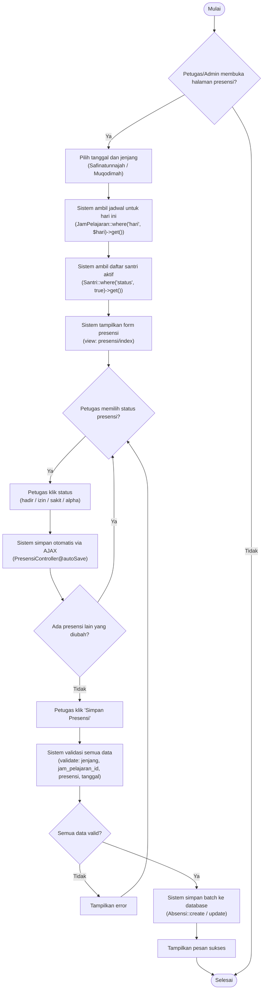
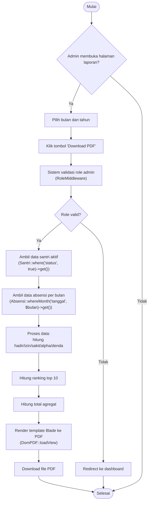
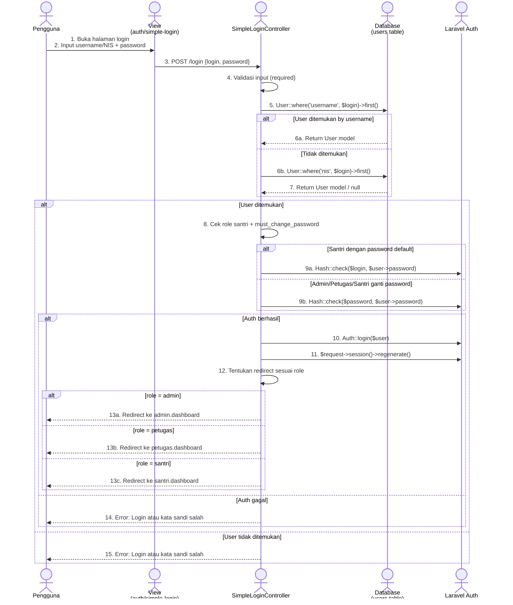
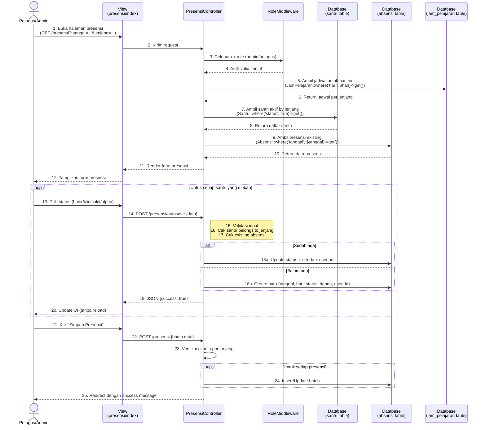
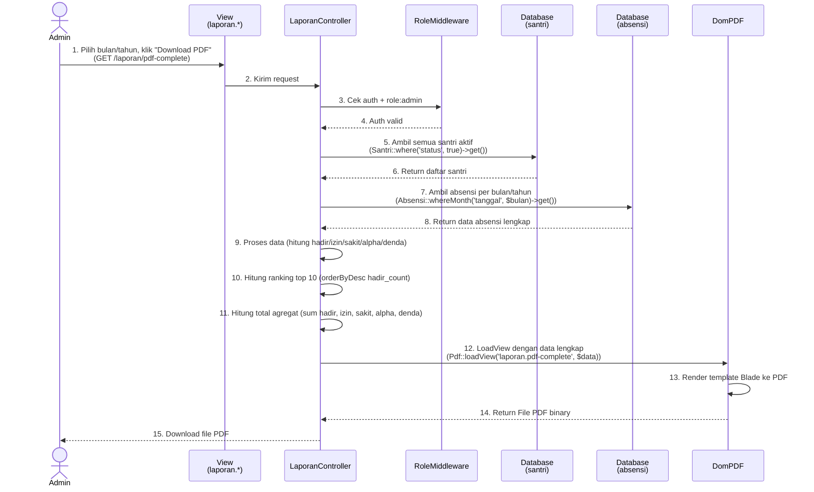
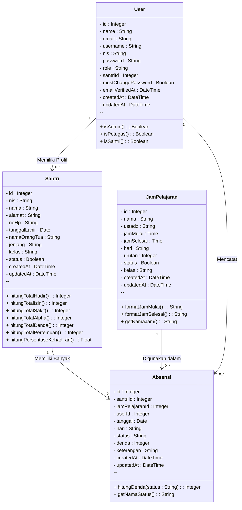
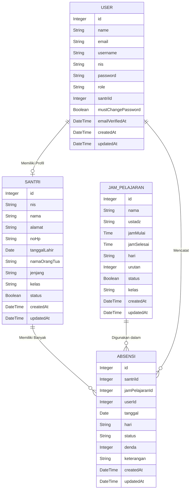

# PERANCANGAN SISTEM
## Sistem Presensi Madrasah Diniyah Salafiyah Pondok Pesantren Tahfidzul Qur'an Al-Asy'ariyyah

---

## 1. Use Case Diagram

### 1.1 Diagram

```mermaid
graph TB
    subgraph "Aktor"
        ADMIN["Admin<br/>(Administrator)"]
        PETUGAS["Petugas<br/>(Staff/Operator)"]
        SANTRI["Santri<br/>(Siswa)"]
    end

    subgraph "Use Cases - Manajemen Akun"
        UC_LOGIN["Login ke Sistem"]
        UC_LOGOUT["Logout dari Sistem"]
        UC_GANTI_PASS["Ganti Password"]
    end

    subgraph "Use Cases - Admin"
        UC_KELOLA_SANTRI["Kelola Data Santri"]
        UC_RESET_PASS_SANTRI["Reset Password Santri"]
        UC_ATUR_JADWAL["Kelola Jadwal Pelajaran"]
        UC_INPUT_PRESENSI["Input/Edit Presensi"]
        UC_REKAP_PRESENSI["Lihat Rekap Presensi Bulanan"]
        UC_REKAP_DENDA["Lihat Rekap Denda"]
        UC_RANKING["Lihat Ranking Kehadiran"]
        UC_EXPORT_EXCEL["Export Excel"]
        UC_PRINT_LAPORAN["Print Laporan"]
        UC_GEN_PDF["Generate Laporan PDF"]
        UC_KELOLA_USERS["Kelola Users"]
        UC_PENGATURAN["Pengaturan Sistem"]
        UC_DASHBOARD_ADMIN["Lihat Dashboard Admin"]
        UC_STATISTIK["Lihat Statistik Bulanan"]
        UC_EDIT_PROFIL["Edit Profil Admin"]
    end

    subgraph "Use Cases - Petugas"
        UC_DASHBOARD_PETUGAS["Lihat Dashboard Petugas"]
        UC_PRESENSI_PETUGAS["Input/Edit Presensi"]
        UC_JADWAL_HARI_INI["Lihat Jadwal Hari Ini"]
    end

    subgraph "Use Cases - Santri"
        UC_DASHBOARD_SANTRI["Lihat Dashboard Pribadi"]
        UC_RIWAYAT_ABSEN["Lihat Riwayat Absensi"]
        UC_RIWAYAT_DENDA["Lihat Riwayat Denda"]
        UC_RANKING_SANTRI["Lihat Ranking Kehadiran"]
        UC_STATISTIK_SANTRI["Lihat Statistik Pribadi"]
        UC_EDIT_PROFIL_SANTRI["Edit Profil Pribadi"]
    end

    ADMIN --> UC_LOGIN
    ADMIN --> UC_LOGOUT
    ADMIN --> UC_GANTI_PASS
    ADMIN --> UC_KELOLA_SANTRI
    ADMIN --> UC_RESET_PASS_SANTRI
    ADMIN --> UC_ATUR_JADWAL
    ADMIN --> UC_INPUT_PRESENSI
    ADMIN --> UC_REKAP_PRESENSI
    ADMIN --> UC_REKAP_DENDA
    ADMIN --> UC_RANKING
    ADMIN --> UC_EXPORT_EXCEL
    ADMIN --> UC_PRINT_LAPORAN
    ADMIN --> UC_GEN_PDF
    ADMIN --> UC_KELOLA_USERS
    ADMIN --> UC_PENGATURAN
    ADMIN --> UC_DASHBOARD_ADMIN
    ADMIN --> UC_STATISTIK
    ADMIN --> UC_EDIT_PROFIL

    PETUGAS --> UC_LOGIN
    PETUGAS --> UC_LOGOUT
    PETUGAS --> UC_GANTI_PASS
    PETUGAS --> UC_DASHBOARD_PETUGAS
    PETUGAS --> UC_PRESENSI_PETUGAS
    PETUGAS --> UC_JADWAL_HARI_INI

    SANTRI --> UC_LOGIN
    SANTRI --> UC_LOGOUT
    SANTRI --> UC_GANTI_PASS
    SANTRI --> UC_DASHBOARD_SANTRI
    SANTRI --> UC_RIWAYAT_ABSEN
    SANTRI --> UC_RIWAYAT_DENDA
    SANTRI --> UC_RANKING_SANTRI
    SANTRI --> UC_STATISTIK_SANTRI
    SANTRI --> UC_EDIT_PROFIL_SANTRI
```



**Gambar 1. Use Case Diagram Sistem Presensi**

### 1.2 Penjelasan Akademik

**Tujuan Diagram**
Use Case Diagram ini bertujuan untuk mengidentifikasi dan memetakan seluruh fungsi yang dapat dilakukan oleh setiap aktor (pengguna) terhadap sistem. Diagram ini memberikan gambaran keseluruhan cakupan sistem dari perspektif pengguna tanpa menampilkan detail implementasi teknis.

**Aktor**
Sistem memiliki tiga aktor utama yang berasal dari role pengguna yang didefinisikan dalam `RoleMiddleware`:
1. **Admin** — Pengguna dengan hak akses penuh, memiliki kontrol penuh terhadap seluruh modul sistem.
2. **Petugas** — Pengguna dengan hak akses terbatas, hanya dapat mengakses modul presensi dan dashboard.
3. **Santri** — Pengguna dengan hak akses paling terbatas, hanya dapat melihat data pribadin dan tidak dapat melakukan perubahan data.

**Fungsi Masing-Masing Aktor**
- **Admin**: Bertanggung jawab penuh atas pengelolaan sistem, termasuk manajemen data master (santri, jadwal, users), pencatatan presensi, pelaporan, dan pengaturan sistem.
- **Petugas**: Bertugas untuk melakukan pencatatan presensi harian dan memantau progress kehadiran santri melalui dashboard.
- **Santri**: Hanya dapat mengakses informasi pribadi terkait kehadiran, denda, dan ranking tanpa kemampuan mengubah data.

**Fungsi Setiap Use Case**
| Use Case | Fungsi |
|-----------|--------|
| UC_LOGIN | Autentikasi pengguna menggunakan username/NIS dan password |
| UC_LOGOUT | Menghapus session dan keluar dari sistem |
| UC_GANTI_PASS | Mengubah password pengguna |
| UC_KELOLA_SANTRI | CRUD data santri (Tambah, Lihat, Edit, Hapus) |
| UC_RESET_PASS_SANTRI | Mereset password santri ke NIS default |
| UC_ATUR_JADWAL | Mengelola jadwal pelajaran per hari dan jenjang |
| UC_INPUT_PRESENSI | Mencatat kehadiran santri per sesi pelajaran |
| UC_REKAP_PRESENSI | Melihat rekapitulasi presensi bulanan |
| UC_REKAP_DENDA | Melihat total denda yang terakumulasi |
| UC_RANKING | Melihat peringkat kehadiran santri |
| UC_EXPORT_EXCEL | Mengunduh laporan dalam format Excel |
| UC_PRINT_LAPORAN | Mencetak laporan melalui browser |
| UC_GEN_PDF | Mengunduh laporan dalam format PDF |
| UC_KELOLA_USERS | Mengelola akun pengguna lain |
| UC_PENGATURAN | Menyesetel sistem (reset data) |
| UC_DASHBOARD_ADMIN | Melihat statistik lengkap sistem |
| UC_STATISTIK | Melihat grafik statistik bulanan |
| UC_EDIT_PROFIL | Mengubah data profil akun sendiri |

**Catatan tentang Relasi Include/Extend**
Tidak ada relasi `<<include>>` atau `<<extend>>` yang digunakan dalam diagram ini karena setiap use case dianggap berdiri sendiri dan tidak ada kasus dimana satu use case harus selalu memanggil use case lain secara wajib.

---

## 2. Activity Diagram

### 2.1 Activity Diagram - Proses Login

```mermaid
flowchart TD
    A([Mulai]) --> B{Pengguna membuka halaman login?}
    B -->|Ya| C["Tampilkan form login<br/>(auth/simple-login)"]
    C --> D["Input username/NIS dan password"]
    D --> E["Klik tombol 'Login'"]
    E --> F["Validasi input<br/>(required)"]
    F --> G{Input valid?}
    G -->|Tidak| H["Tampilkan error"]
    H --> D
    G -->|Ya| I["Cari user by username<br/>(User::where('username', $login)->first())"]
    I --> J{User ditemukan?}
    J -->|Tidak| K["Cari user by NIS<br/>(User::where('nis', $login)->first())"]
    K --> L{User ditemukan?}
    L -->|Tidak| M["Tampilkan error<br/>'Login atau kata sandi salah'"]
    M --> D
    J -->|Ya| N["Cek apakah santri dengan password default<br/>(role = santri && must_change_password)"]
    L -->|Ya| N
    N --> O{Santri + must_change_password?}
    O -->|Ya| P["Verifikasi password = NIS<br/>(Hash::check($login, $user->password))"]
    O -->|Tidak| Q["Verifikasi password input<br/>(Hash::check($password, $user->password))"]
    P --> R{Password sesuai?}
    Q --> R
    R -->|Tidak| M
    R -->|Ya| S["Login user + regenerate session<br/>(Auth::login + regenerate)"]
    S --> T{Cek role user<br/>($user->role)}
    T -->|admin| U["Redirect ke admin.dashboard"]
    T -->|petugas| V["Redirect ke petugas.dashboard"]
    T -->|santri| W["Redirect ke santri.dashboard"]
    U --> X([Selesai])
    V --> X
    W --> X
    B -->|Tidak| X
```

**Gambar 2. Activity Diagram Proses Login**

**Penjelasan:**
- **Tujuan Proses**: Mengautentikasi pengguna dan mengarahkannya ke dashboard sesuai peran.
- **Alur Aktivitas**: Dimulai dari buka halaman login → input kredensial → validasi → cari user di database → verifikasi password → login → redirect sesuai role.
- **Keputusan yang Terjadi**:
  - Input valid/tidak valid
  - User ditemukan/tidak ditemukan
  - Apakah santri dengan password default
  - Password sesuai/tidak sesuai
  - Role user (admin/petugas/santri)
- **Hasil Akhir**: Redirect ke dashboard yang sesuai, atau tetap di halaman login dengan pesan error.

---

### 2.2 Activity Diagram - Proses Input Presensi



**Gambar 3. Activity Diagram Proses Input Presensi**

**Penjelasan:**
- **Tujuan Proses**: Mencatat kehadiran santri secara harian dengan validasi dan autosave.
- **Alur Aktivitas**: Buka halaman → pilih tanggal/jenjang → sistem muat data → form presensi → pilih status → autosave → simpan batch.
- **Keputusan yang Terjadi**:
  - Apakah halaman presensi dibuka
  - Apakah ada perubahan status lain (loop)
  - Apakah semua data valid sebelum disimpan
- **Hasil Akhir**: Data presensi tersimpan di tabel `absensi` dan menampilkan pesan sukses.

---

### 2.3 Activity Diagram - Proses Cetak Laporan PDF



**Gambar 4. Activity Diagram Proses Cetak Laporan PDF**

**Penjelasan:**
- **Tujuan Proses**: Menghasilkan laporan PDF bulanan lengkap untuk admin.
- **Alur Aktivitas**: Buka halaman laporan → pilih periode → validasi role → ambil data → proses agregasi → render PDF → download.
- **Keputusan yang Terjadi**:
  - Apakah halaman laporan dibuka
  - Apakah role user adalah admin
- **Hasil Akhir**: File PDF siap diunduh.

---

## 3. Sequence Diagram

### 3.1 Sequence Diagram - Proses Login



**Gambar 5. Sequence Diagram Proses Login**

**Penjelasan:**
- **Urutan Komunikasi**: Pengguna → View → Controller → Database → Auth Laravel → Controller → Pengguna.
- **Objek yang Terlibat**: `Pengguna`, `View (auth/simple-login)`, `SimpleLoginController`, `Database (tabel users)`, `Laravel Auth`.
- **Proses yang Terjadi**:
  1. Pengguna menginput kredensial di form login.
  2. View mengirimkan POST request ke controller.
  3. Controller memvalidasi input.
  4. Controller mencari user di database, pertama berdasarkan username, lalu NIS.
  5. Jika ditemukan, controller mengecek apakah santri dengan password default.
  6. Password diverifikasi dengan Hash::check.
  7. Jika cocok, login dilakukan, session diregenerasi, dan user diarahkan ke dashboard sesuai role.

---

### 3.2 Sequence Diagram - Proses Input Presensi



**Gambar 6. Sequence Diagram Proses Input Presensi**

**Penjelasan:**
- **Urutan Komunikasi**: Petugas/Admin → View → Controller → Middleware → Database (3 tabel) → Controller → View → Petugas/Admin.
- **Objek yang Terlibat**: `Petugas/Admin`, `View (presensi/index)`, `PresensiController`, `RoleMiddleware`, `Database (santri, absensi, jam_pelajaran)`.
- **Proses yang Terjadi**:
  1. Petugas membuka halaman presensi dengan parameter tanggal dan jenjang.
  2. Controller meneruskan request ke RoleMiddleware untuk validasi otentikasi.
  3. Jika valid, controller mengambil data jadwal, santri aktif, dan presensi existing dari database.
  4. Form presensi dirender dan ditampilkan.
  5. Setiap kali petugas mengubah status santri, autosave AJAX dipanggil untuk menyimpan individual record.
  6. Setelah semua presensi diatur, petugas klik "Simpan Presensi" untuk menyimpan batch.
  7. Data disimpan ke tabel `absensi` dengan status dan denda yang sesuai.

---

### 3.3 Sequence Diagram - Proses Cetak Laporan PDF



**Gambar 7. Sequence Diagram Proses Cetak Laporan PDF**

**Penjelasan:**
- **Urutan Komunikasi**: Admin → View → Controller → Middleware → Database (santri + absensi) → Controller → DomPDF → Admin.
- **Objek yang Terlibat**: `Admin`, `View (laporan.*)`, `LaporanController`, `RoleMiddleware`, `Database (santri, absensi)`, `DomPDF`.
- **Proses yang Terjadi**:
  1. Admin memilih periode laporan dan mengirim request.
  2. Controller memverifikasi role admin melalui middleware.
  3. Controller mengambil seluruh data santri aktif dan absensi pada bulan/tahun yang dipilih.
  4. Data diproses untuk menghitung agregat (hadir, izin, sakit, alpha, denda) dan ranking top 10.
  5. Data diserahkan ke library DomPDF untuk dirender berdasarkan template Blade.
  6. File PDF dihasilkan dan diunduh oleh admin.

---

## 4. Class Diagram

### 4.1 Diagram



**Gambar 8. Class Diagram Sistem Presensi**

### 4.2 Penjelasan Akademik

**Kelas dan Atribut**
Diagram ini merepresentasikan empat kelas utama yang diimplementasikan sebagai Model Laravel:

1. **User** — Mewakili seluruh pengguna sistem (admin, petugas, santri). Atribut `role` membedakan peran, `santriId` menghubungkan ke profil santri, dan `mustChangePassword` mengontrol flow ganti password pertama.
2. **Santri** — Mewakili data profil santri. Atribut `jenjang` dan `kelas` mengklasifikasikan santri ke dalam program pendidikan yang sesuai.
3. **Absensi** — Entitas penghubung yang mencatat setiap transaksi kehadiran. Atribut `status` dan `denda` adalah inti dari perhitungan presensi.
4. **JamPelajaran** — Mewakili jadwal pelajaran yang terstruktur per hari, jenjang, dan urutan.

**Operasi (Method)**
Operasi yang ditampilkan adalah fungsi bisnis yang relevan, bukan method khusus framework:
- `hitungTotalHadir()`, `hitungTotalIzin()`, `hitungTotalSakit()`, `hitungTotalAlpha()`, `hitungTotalDenda()`, `hitungTotalPertemuan()`, `hitungPersentaseKehadiran()`: Agregasi data kehadiran santri.
- `hitungDenda()`: Menghitung nominal denda berdasarkan status presensi.
- `getNamaStatus()`: Mengembalikan label status presensi.
- `isAdmin()`, `isPetugas()`, `isSantri()`: Pemeriksaan role pengguna.

**Relationship dan Multiplicity**
| Relasi | Multiplicity | Penjelasan |
|--------|--------------|------------|
| User → Santri (Memiliki Profil) | `1 → 0..1` | Setiap user dengan role santri terhubung ke satu santri. Admin dan petugas memiliki `santriId = null`. |
| Santri → Absensi (Memiliki Banyak) | `1 → 0..*` | Satu santri dapat memiliki banyak record absensi (minimal 0 jika baru masuk). |
| JamPelajaran → Absensi (Digunakan dalam) | `1 → 0..*` | Satu jadwal dapat digunakan dalam banyak absensi. |
| User → Absensi (Mencatat) | `1 → 0..*` | Satu user dapat mencatat banyak absensi. |

**Inheritance dan Dependency**
- **Inheritance**: Tidak ada inheritance antar kelas Model. Semua model mewarisi dari `Illuminate\Database\Eloquent\Model` secara implisit, tetapi tidak ditampilkan karena bukan bagian dari domain model bisnis.
- **Dependency**: Kelas `Absensi` bergantung pada `Santri`, `JamPelajaran`, dan `User` untuk menghitung denda dan menampilkan label status. Kelas `User` bergantung pada `Santri` untuk relasi profil.

---

## 5. Entity Relationship Diagram (ERD)

### 5.1 Diagram



**Gambar 9. Entity Relationship Diagram (ERD) Sistem Presensi**

### 5.2 Penjelasan Akademik

**Entitas dan Atribut**
ERD ini merepresentasikan struktur basis data yang diimplementasikan dalam migration files:

1. **USER**
   - Atribut `id`: Primary key unik untuk setiap pengguna.
   - Atribut `role`: Menyimpan peran pengguna (`admin`, `petugas`, `santri`).
   - Atribut `santriId`: Foreign key opsional yang menghubungkan user dengan profil santri.
   - Atribut `nis` dan `username`: Kolom unik untuk login.
   - Atribut `mustChangePassword`: Flag boolean untuk memaksa ganti password pertama.

2. **SANTRI**
   - Atribut `nis`: Primary key alami (nomor induk santri) yang unik.
   - Atribut `jenjang`: Menyimpan program pendidikan (`Safinatunnajah` atau `Muqodimah`).
   - Atribut `status`: Menandakan apakah santri aktif atau non-aktif.
   - Atribut `kelas`: Menyimpan kelas santri (opsional).

3. **JAM_PELAJARAN**
   - Atribut `nama`, `ustadz`, `jamMulai`, `jamSelesai`: Menyimpan detail jadwal pelajaran.
   - Atribut `hari`: Hari dalam seminggu.
   - Atribut `urutan`: Urutan jam pelajaran dalam sehari.
   - Atribut `kelas`: Menentukan jadwal untuk program `Safinatunnajah` atau `Muqodimah`.

4. **ABSENSI**
   - Atribut `santriId`: Foreign key ke tabel `santri`.
   - Atribut `jamPelajaranId`: Foreign key ke tabel `jam_pelajaran`.
   - Atribut `userId`: Foreign key ke tabel `users` (pencatat).
   - Atribut `tanggal` dan `hari`: Menandakan kapan presensi dilakukan.
   - Atribut `status`: Menyimpan kondisi kehadiran (`hadir`, `izin`, `sakit`, `alpha`).
   - Atribut `denda`: Nilai denda yang dihitung otomatis berdasarkan status.

**Relationship dan Cardinality**
| Relationship | Cardinality | Penjelasan |
|--------------|-------------|------------|
| USER → SANTRI (Memiliki Profil) | `1 → 0..1` | Satu user dengan role santri terhubung ke satu santri. Admin dan petugas tidak memiliki profil santri. |
| SANTRI → ABSENSI (Memiliki Banyak) | `1 → 0..*` | Satu santri dapat memiliki banyak record absensi. |
| JAM_PELAJARAN → ABSENSI (Digunakan dalam) | `1 → 0..*` | Satu jadwal dapat digunakan dalam banyak record absensi. |
| USER → ABSENSI (Mencatat) | `1 → 0..*` | Satu user dapat mencatat banyak absensi. |

**Primary Key dan Foreign Key**
- Setiap entitas memiliki atribut `id` sebagai primary key.
- Tabel `absensi` memiliki tiga foreign key: `santriId` (referensi ke `santri.id`), `jamPelajaranId` (referensi ke `jam_pelajaran.id`), dan `userId` (referensi ke `users.id`).
- Tabel `users` memiliki foreign key `santriId` yang opsional (nullable) untuk menghubungkan user dengan profil santri.

---

*Dokumen perancangan sistem ini disusun berdasarkan analisis terhadap kode sumber sistem yang sedang berjalan. Tidak ada perubahan atau modifikasi yang diajukan terhadap struktur logika, kode, atau tampilan sistem yang sudah ada.*
